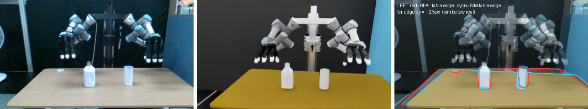
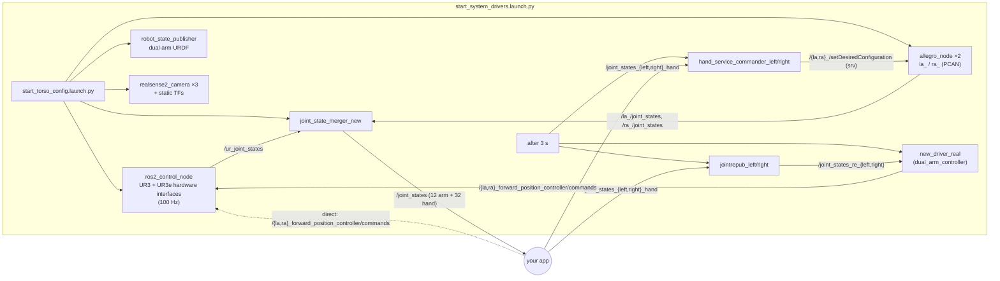
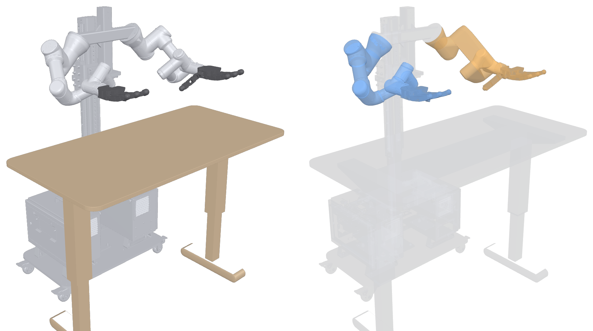

# Dual-Arm UR3 / UR3e + Allegro Hand V4 — ROS 2 Jazzy Drivers

**The ROS 2 workspace that runs a bimanual torso:** a UR3 (right) and a UR3e (left) on a T-shaped stand, each
carrying a 16-DoF Allegro Hand V4, plus up to three Intel RealSense cameras. One launch file brings up both
arms (`ros2_control` + the Universal Robots driver), both hands (a customised Allegro driver over PCAN-USB),
the cameras with calibrated intrinsics and extrinsics, a unified `/joint_states`, and the bridge nodes that
let an external program (an Isaac Lab policy, a grasp planner, teleoperation) drive the whole cell with
plain joint-position topics.

<p align="center">
  <br/>
  <sub>Left to right: the real cell, its URDF digital twin from the same calibrated camera pose, and the
  overlay (red = real table edge, cyan = twin).</sub>
</p>

**Project page:** https://ismael-esp.github.io/dual-arm-allegro-ros2/

Projects that run on top of these drivers:
[dexterous-pick-and-place](https://github.com/ismael-esp/dexterous-pick-and-place) (grasp synthesis plus
pick-and-place, 94/100 on hardware) and
[foundationpose-ros2-tracker](https://github.com/ismael-esp/foundationpose-ros2-tracker) (6D object tracking).

---

## Contents

- [Hardware](#hardware)
- [What runs](#what-runs)
- [Robot description: URDF and collision model](#robot-description-urdf-and-collision-model)
- [Repository layout](#repository-layout)
- [Installation](#installation)
- [Bring-up](#bring-up)
- [Commanding the robot](#commanding-the-robot)
- [Configuration](#configuration)
- [Calibration](#calibration)
- [Troubleshooting](#troubleshooting)
- [Licenses and credits](#licenses-and-credits)

## Hardware

| Component | Model | Connection | ROS prefix / namespace |
|---|---|---|---|
| Right arm | Universal Robots **UR3** (CB-series) | Ethernet, `192.168.0.120`, External Control URCap | `ra_` |
| Left arm | Universal Robots **UR3e** | Ethernet, `192.168.0.121`, External Control URCap | `la_` |
| Right hand | Wonik **Allegro Hand V4**, serial P231 | PEAK PCAN-USB, channel 33 (`/dev/pcanusb33`) | `ra_` |
| Left hand | Wonik **Allegro Hand V4**, serial P249 | PEAK PCAN-USB, channel 32 (`/dev/pcanusb32`) | `la_` |
| Cameras | Intel RealSense D415 (×3) | USB 3 | `front_right/cam1`, `extra/cam2`, `front_left/cam3` |
| Stand + table | Custom aluminium T-stand, motorised desk | modelled in the URDF | `ur_stand`, `table` |

The PCAN channel numbers come from USB enumeration order. If a hand does not answer, swap `channel` in
`start_torso_config.launch.py` (see [Troubleshooting](#troubleshooting)).

## What runs



| Node | Package / executable | Role |
|---|---|---|
| `ros2_control_node` | `controller_manager` | Both UR hardware interfaces in one controller manager. Publishes `/ur_joint_states`. |
| `dashboard_client`, `urscript_interface`, `controller_stopper` | `ur_robot_driver` | Per arm (`la`/`ra` namespaces): power, brake, program control. |
| `allegro_node` ×2 | `allegro_hand_ros` | Hand driver (PID joint-position control over CAN), `/<ns>/joint_states`, `/<ns>/setDesiredConfiguration`. |
| `joint_state_merger_new` | `my_dual_robot_cell_control` | Merges arm and hand states into one `/joint_states` (44 joints) at 100 Hz. |
| `new_driver_real` (`dual_arm_controller`) | `my_dual_robot_cell_control` | Closed-loop streaming of arm targets to the forward position controllers, with damping against swinging. |
| `jointrepub_left/right` | `my_dual_robot_cell_control` | Reorders `/joint_states_{left,right}_hand` (sim joint order) into the controller order. |
| `hand_service_commander_left/right` | `my_dual_robot_cell_control` | Streams hand targets from `/joint_states_{left,right}_hand` to the Allegro service at 100 Hz, and releases the hand when the topic goes silent. |
| `realsense2_camera` ×3 + `static_transform_publisher` | `realsense2_camera` (patched) | Colour + depth, calibrated colour intrinsics via `color.camera_info_url`, camera→`world` extrinsics. |

**Controllers** (`config/combined_controllers.yaml`), per arm: `*_forward_position_controller` (active by
default, used for streaming), `*_scaled_joint_trajectory_controller`, `*_joint_trajectory_controller`,
`*_forward_velocity_controller`, plus the joint-state, speed-scaling, force-torque and IO/status broadcasters.

## Robot description: URDF and collision model

<p align="center">
  <br/>
  <sub>The expanded URDF at the home pose. Left: visual meshes. Right: collision geometry (right arm and hand
  blue, left arm and hand orange, stand and table grey).</sub>
</p>

The description is generated by xacro at launch time:

```
my_dual_robot_cell_control/urdf/my_dual_robot_cell_controlled.urdf.xacro      ← loaded by rsp.launch.py
├── my_dual_robot_cell_description/urdf/tshape_dual_v2.xacro                   ← world, T-stand, table, both arms
│   ├── my_dual_robot_cell_control/urdf/ur_macro_left.xacro   (UR3e + left Allegro, la_ prefix)
│   └── my_dual_robot_cell_control/urdf/ur_macro_right.xacro  (UR3  + right Allegro, ra_ prefix)
└── ur_robot_driver/urdf/ur.ros2_control.xacro  ×2                             ← hardware interfaces (IPs, scripts)
```

- **Kinematics.** The arm mounts follow the measured T-stand geometry. Each arm's factory DH calibration
  is in `config/{left,right}_tshape_calibration.yaml` (extracted with `ur_calibration`).
- **Hands.** The Allegro links are prefixed `la_` / `ra_`. Fingertip links (`*_link_{3,7,11,15}_0_tip`)
  are the contact frames, and `*_palm_link` is the hand frame used by planners.
- **Collision.** The UR arms use the official collision meshes, the hands use per-link STL meshes, and the
  stand and table use simplified meshes. MoveIt self-collision pairs are in
  `my_dual_robot_cell_moveit_config/config/my_dual_robot_cell.srdf`.
- **Simulation copies.** `urdf/{la_ur3e,ra_ur3}_allegro_isaac_.urdf` are flattened single-arm URDFs, with
  converted USDs alongside, as imported into Isaac Lab for sim-to-real work.

Inspect it yourself:

```bash
# the full torso in RViz without hardware (mock arms, see Bring-up)
ros2 launch my_dual_robot_cell_control start_robots.launch.py la_use_mock_hardware:=true ra_use_mock_hardware:=true
xacro src/my_dual_robot_cell/my_dual_robot_cell_control/urdf/my_dual_robot_cell_controlled.urdf.xacro \
      la_ur_type:=ur3e ra_ur_type:=ur3 la_robot_ip:=0.0.0.0 ra_robot_ip:=0.0.0.0 > /tmp/cell.urdf
check_urdf /tmp/cell.urdf
```

## Repository layout

```
dual_arm.repos                 pinned upstream drivers (UR driver 3.3.3 @ f7bbe92, ur_description 3.2.0,
                               realsense-ros @ bafc210), fetched with vcs
patches/realsense-ros.patch    camera_info_url support (load calibrated intrinsics from YAML), launch
                               defaults, cam2 intrinsics, cam_tf_tuner.py and table_tilt.py calibration tools
docker/                        Dockerfile (ROS 2 Jazzy + ros2_control + UR + MoveIt + librealsense + PCAN libs),
                               build.sh, run.sh
scripts/                       setup_workspace.sh (vcs import + patch + colcon build), install_pcan_host.sh
.config/cyclonedds/            DDS configuration shared by the container and the host
src/
  my_dual_robot_cell/
    my_dual_robot_cell_control/      launch files, controllers, calibration, URDF xacros + meshes, nodes
    my_dual_robot_cell_description/  cell description (T-stand, table, both arms)
    my_dual_robot_cell_moveit_config/ MoveIt 2 config (SRDF, kinematics, limits)
  my_robot_cell/my_robot_cell_description/  single-arm base description (meshes reused by the cell)
  allegro_hand_cust/                 Allegro Hand V4 driver used in production (PCAN, C++ library, ROS 2 node,
                                     interfaces, description)
  allegro_hand_wonik/                vendor Allegro ROS 2 driver (SocketCAN), used by start_robots.launch.py
docs/                          project page and media
```

## Installation

The drivers run inside a Docker container (Ubuntu 24.04 + ROS 2 Jazzy). Host tools (perception, policies,
planners) talk to it over DDS on the same machine or network.

### 1. Host: PCAN kernel driver (once per kernel)

```bash
bash scripts/install_pcan_host.sh      # builds peak-linux-driver 8.20.0 (chardev mode) and loads `pcan`
ls /dev/pcanusb*                       # → /dev/pcanusb32 /dev/pcanusb33 with both hands connected
```

### 2. Build the image

```bash
git clone https://github.com/ismael-esp/dual-arm-allegro-ros2.git
cd dual-arm-allegro-ros2
bash docker/build.sh                   # image dual-arm-allegro:jazzy (~6 GB)
```

### 3. Fetch the drivers and build the workspace (inside the container)

```bash
bash docker/run.sh                     # repo mounted at /home/dev/ros2_ws, host network, /dev, X11
bash scripts/setup_workspace.sh        # vcs import + RealSense patch + colcon build
source install/setup.bash
```

The launch files reference config files under `/home/dev/ros2_ws/...`, which is why `docker/run.sh`
mounts the repo at exactly that path.

**Tested** from a fresh clone in a fresh image: all 24 packages build (about 2 min), the URDF passes
`check_urdf`, and the mock bring-up activates every controller. A command streamed to
`ra_forward_position_controller` moves the mock arm to its target. The real-hardware launch is the
configuration this cell runs every day. It was not re-run from the clone, because that needs the robots,
hands and cameras attached.

### 4. Robot-side setup

- **UR arms.** Install the *External Control* URCap on both controllers. Set the host IP and port 50002, and
  give the PC a static IP on `192.168.0.x`. Run the program after the drivers are up, or use headless mode.
- **Network / DDS.** Use `ROS_DOMAIN_ID=10`, `RMW_IMPLEMENTATION=rmw_cyclonedds_cpp` and
  `CYCLONEDDS_URI=.config/cyclonedds/cyclonedds.xml` on every machine that should see the robot. The image
  sets these, and you must export the same on the host.
- **Cameras.** Put each camera's serial number in `start_torso_config.launch.py` (`camX_serial`, with the
  leading `_`).

## Bring-up

```bash
# everything: arms + hands + cameras + merger + commanders + bridges (+ RViz)
ros2 launch my_dual_robot_cell_control start_system_drivers.launch.py

# alternative bring-up: arms + hands through the vendor Wonik SocketCAN driver (can0/can1);
# with mock arms it runs without any robot (the hand nodes then just report "can0: No such device")
ros2 launch my_dual_robot_cell_control start_robots.launch.py \
    la_use_mock_hardware:=true ra_use_mock_hardware:=true launch_rviz:=false
```

`start_robots.launch.py` starts the arms on `*_scaled_joint_trajectory_controller`. To stream positions, switch
controllers first:

```bash
ros2 control switch_controllers --activate ra_forward_position_controller \
                                --deactivate ra_scaled_joint_trajectory_controller
```

Check it:

```bash
ros2 control list_controllers                # *_forward_position_controller active
ros2 topic hz /joint_states                  # ~100 Hz, 44 joints
ros2 run my_dual_robot_cell_control test_hardware_connection   # arms + hands respond (small motions)
ros2 run my_dual_robot_cell_control test_right_hand            # right hand open/close
ros2 run my_dual_robot_cell_control home_arms                  # both arms to home, hands open
```

`test_*` and `home_arms` move the real robot. Clear the workspace first.

## Commanding the robot

Two ways, both plain topics:

**A. Direct arm streaming** (used by the pick-and-place runner):

```bash
# 6 joint positions [rad] in order shoulder_pan, shoulder_lift, elbow, wrist_1, wrist_2, wrist_3
ros2 topic pub --once /ra_forward_position_controller/commands std_msgs/msg/Float64MultiArray "{data: [...]}"
```

Stream small increments at 100–125 Hz. The forward controller jumps to whatever it receives.

**B. Whole-arm-plus-hand bridge** (used for sim-to-real policy deployment): publish a
`sensor_msgs/JointState` with the arm joints (`ra_shoulder_pan_joint`, …) and the 16 hand joints on
`/joint_states_right_hand` (or `_left_hand`). `jointrepub_*` and `new_driver_real` stream the arm, and
`hand_service_commander_*` streams the hand.

**Hands only:** call the service `/ra_/setDesiredConfiguration` (`allegro_hand_interfaces/srv/SetDesPos`) with
16 joint angles. Joints 0–3 index, 4–7 middle, 8–11 ring, 12–15 thumb. Open is
`[0,-0.15,-0.15,-0.15, 0,-0.15,-0.15,-0.15, 0,-0.15,-0.15,-0.15, 0.5,-0.1,-0.1,-0.1]`.

## Configuration

| What | Where |
|---|---|
| Robot IPs, UR types, mock hardware, initial controller, RViz | launch args in `start_torso_config.launch.py` / `start_robots.launch.py` |
| Controller set and joint lists | `config/combined_controllers.yaml`, rate in `config/update_rate.yaml` (100 Hz) |
| Arm kinematic calibration | `config/{left,right}_tshape_calibration.yaml` (`{la,ra}_calibration.yaml` = previous table setup) |
| Hand gains, limits, controllers | `src/allegro_hand_cust/allegro_hand/conf/` (`configuration_files/V4P231.yaml`, `V4P249.yaml`, `controllers/`, `joints_limits/`) |
| Hand CAN channel, side, prefix, initial controller | `la_allegro_launch` / `ra_allegro_launch` in `start_torso_config.launch.py` |
| Camera serials, namespaces, resolution, extrinsics, intrinsics YAML | `camX_*` launch args in `start_torso_config.launch.py` (default 1280×720 @ 30 fps) |
| Hand streaming delay and rate | parameters `delay_s`, `publish_rate` of `hand_service_commander_*` |
| DDS | `.config/cyclonedds/cyclonedds.xml` |

**Allegro driver changes vs. the original UPC library** are documented in
`src/allegro_hand_cust/allegro_hand/DRIVER_CHANGES.md`. The main one enforces the per-joint PWM ceiling to
stop the thumb-roll motor (joint 12) from overheating and latching a thermal fault. The original code is
quoted there, so it can be rolled back.

## Calibration

- **Arm kinematics:** `ros2 launch ur_calibration calibration_correction.launch.py robot_ip:=<ip>
  target_filename:=.../config/right_tshape_calibration.yaml`, then point the launch arg at it.
- **Camera extrinsics:** hand-eye calibration result → `camX_{x,y,z,qx,qy,qz,qw}` launch args (camera
  link in `world`). Fine-tune live with `cam_tf_tuner.py` and check the residual with `table_tilt.py`
  (fits the table plane in the point cloud and reports its tilt). Both are added to `src/realsense-ros/` by
  the patch.
- **Camera intrinsics:** a standard `camera_info` YAML (e.g. from `camera_calibration`) passed as
  `camX_color_info_url:=file:///...`. The patched driver uses it only when its resolution matches the
  stream. Otherwise it warns and keeps the factory intrinsics.

## Troubleshooting

| Symptom | Fix |
|---|---|
| Nodes on the host can't see the robot topics | Same `ROS_DOMAIN_ID` (10), `RMW_IMPLEMENTATION=rmw_cyclonedds_cpp` and Cyclone config on both sides. Unset `ROS_LOCALHOST_ONLY`. |
| `allegro_node` can't open the device | `lsmod \| grep pcan` and `ls /dev/pcanusb*` on the host. Rebuild the module after a kernel update (`scripts/install_pcan_host.sh`). |
| Hand stops responding, LED blinking | CAN bus-off. Power-cycle the hand, then restart the drivers. Keep `ki = 0` in the controller gains, keep CAN cables away from motor power, and check termination (≈60 Ω between CAN_H and CAN_L). |
| Wrong hand moves | The channel order changed. Swap `channel` 32/33 in `start_torso_config.launch.py`. |
| Thumb loses torque after holding the hand open | Thermal fault. See `DRIVER_CHANGES.md`. Power-cycle the hand. Avoid holding the thumb at full abduction for long periods. |
| Arm doesn't move, `controller_stopper` deactivates controllers | The External Control program isn't running on the pendant, or the robot is in local mode. |
| Camera fails to start | Wrong serial (keep the leading `_`), or a USB 2 port. `initial_reset` is `true` in the patched launch defaults. |

## Licenses and credits

- `my_dual_robot_cell*`, `my_robot_cell_description`: built from the Universal Robots multi-robot cell example
  (BSD-3-Clause, see the package `LICENSE` / `UR_LICENSE.txt` files), extended for this torso.
- `allegro_hand_cust`: based on the Allegro Hand library and ROS 2 packages by UPC/IOC
  (Leopold Palomo-Avellaneda, Marina Pujol). LGPL-3.0 (`src/allegro_hand_cust/allegro_hand/LICENSE`). Local
  changes are listed in `DRIVER_CHANGES.md`.
- `allegro_hand_wonik`: Wonik Robotics Allegro Hand ROS 2 packages (BSD).
- Upstream drivers fetched by `dual_arm.repos`: [Universal_Robots_ROS2_Driver](https://github.com/UniversalRobots/Universal_Robots_ROS2_Driver)
  (BSD-3), [Universal_Robots_ROS2_Description](https://github.com/UniversalRobots/Universal_Robots_ROS2_Description)
  (BSD-3), [realsense-ros](https://github.com/IntelRealSense/realsense-ros) (Apache-2.0, local patch in `patches/`).
- PEAK PCAN driver: downloaded from [peak-system.com](https://www.peak-system.com/fileadmin/media/linux/index.php)
  at install time, not redistributed.
- New files in this repository (Docker setup, scripts, docs): BSD-3-Clause, see `LICENSE`.

---

Developed 2025-2026 by Ismael Espinoza Jaramillo (PhD candidate, Kyung Hee University) in the lab's private workspace and published here as a clean snapshot in Oct 2026 · [ismael-esp.github.io](https://ismael-esp.github.io) · [github.com/ismael-esp](https://github.com/ismael-esp)
