# Testing the Allegro Hand Library

---
> - 🔙 Go back to the main README file: [0 - Main](../README.md)
> - ⬅️ Previous section: [9 - Installation And Setup](9_InstallationAndSetup.md)
> - ➡️ Next section: [11 - The Official Software](11_TheOfficialSoftware.md)
---

This section will present practical examples of how to use the Allegro
Hand Library.

First off, the necessary requirements have to be installed and the project compilation must be done.
> - More information available in: [9 - Installation And Setup](9_InstallationAndSetup.md)

This section is divided in three parts, where two examples will be deeply explained:
- [1. Allegro Hand Example](#1---allegro-hand-example). Most complete example. Uses the *AllegroHand* Class.
- [2. Allegro Hand Driver Example](#2---allegro-hand-driver-example). Basic Driver Example. Uses the *AllegroHandDriver* Class.
- [3. Additional Examples](#3---additional-examples).

## 1 - Allegro Hand Example

This example program is the most complete one. It demonstrates the usage
of the `AllegroHand` class, which is the main class of the AllegroHand
library. The program allows interaction with the Allegro robotic hand,
enabling various functionalities such as controlling the hand, reading
its state, and performing kinematic calculations.

### 1-1 Functionality 

The example provides several options to interact with the Allegro Hand:

    

- **Select a Controller:** The user can select from available controllers such as Gravity Compensator, PD, PID, or Torque controllers by entering the corresponding number (option `<1>`).

    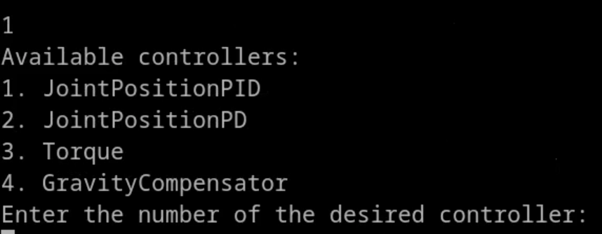

- **Forward Kinematics (FK):** The program computes and prints the Forward Kinematics of the fingertips (option `<2>`). This calculation provides the positions (Cartesian coordinates: X, Y, Z) and orientations (ZYZ Euler angles) of each fingertip.

    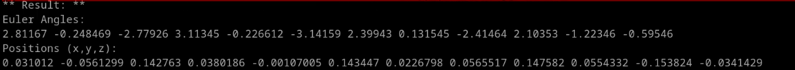

- **Inverse Kinematics (IK):** The user can move the fingertips to a desired position and orientation using Inverse Kinematics (option `<3>`). This requires specifying 12 position values and 12 orientation values of the fingertips.

    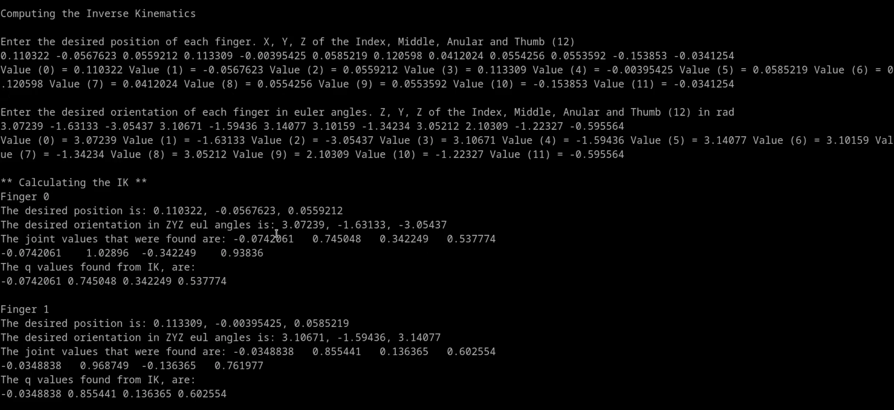
    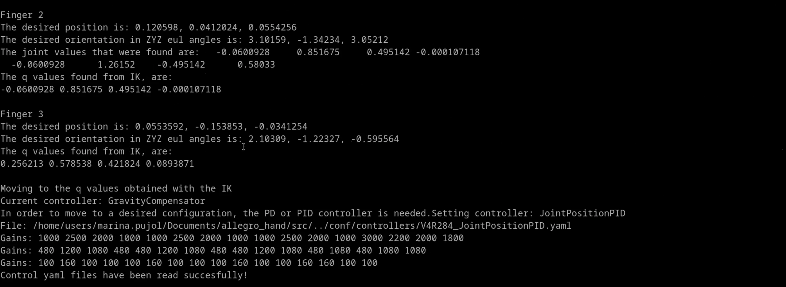

- **Move to a Defined Configuration:** The user can move the hand to a predefined configuration by specifying its name (option `<4>`).

    

- **Read Hand State:** The program reads and displays the current state of the hand, including joint positions in degrees and radians, velocities in degrees per second, accelerations in degrees per second squared, and torques in Newton-meters (option `<5>`).

    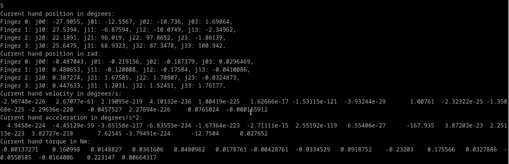

- **Store a Configuration:** The program allows the user to manually move the hand (with the Gravity Compensator automatically activated) and save the current configuration to a YAML file under a specified name (option `<6>`).

    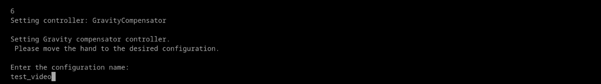
    

- **Perform a Coupled Closing:** The program enables a coupled closing of the hand (option `<8>`).

    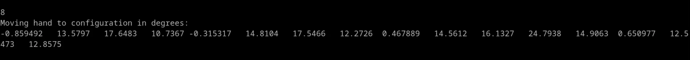

- **Retrieve Configuration List:** The program lists all available configurations stored in the YAML files (option `<G> or <g>`).

    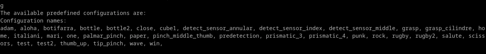

- **Move to a Predefined Configuration at a Desired Velocity:** The user can specify a configuration name and a velocity percentage (up to 100%) to move the hand at the desired speed (option `<X> or <x>`).

    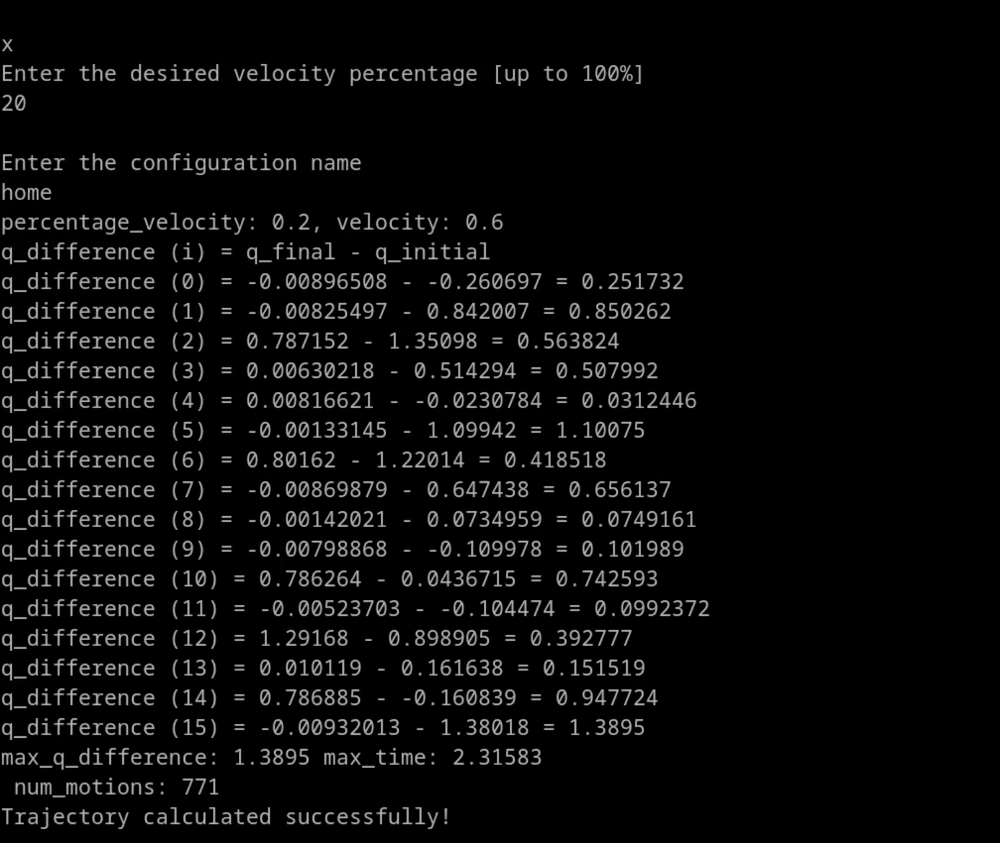

- **Store and Execute a Trajectory:** The user can define a velocity and a final configuration name (option `<Y> or <y>`). The hand moves from the current configuration to the user-selected final configuration.

    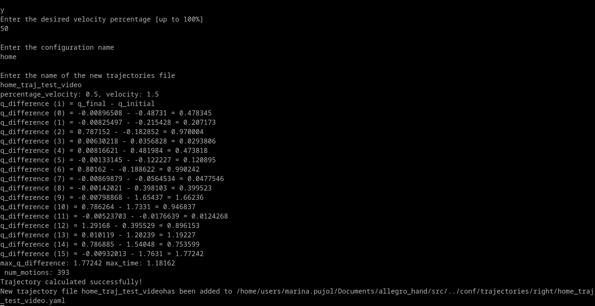

- **Move Along a Predefined Trajectory:** The user can move the hand along a trajectory defined as a list of configurations (`<T> or <t>`).

    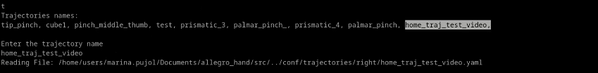

- **Record and Store a Trajectory:** The program can listen to the manually manipulated hand and store the movement trajectory.

    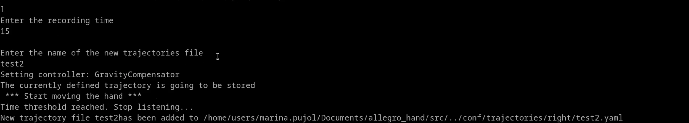

- **Execute grasps:** The program can execute some predefined grasps (option `<i> or <I>`).

    -   **Prismatic grasp using 3 fingers:** Executes a prismatic grasp
        using 3 fingers, the Index, the Middle and the Thumb (option
        `<1>`).

    -   **Prismatic grasp using 4 fingers:** Executes a prismatic grasp
        using all 4 fingers (option `<2>`.

    -   **Pinch grasp using 3 fingers:** Executes a pinch grasp using 2
        fingers, the Index and the Thumb (option `<3>`.

    -   **Pinch grasp using 3 fingers:** Executes a pinch grasp using 2
        fingers, the Middle and the Thumb (option `<3>`.

    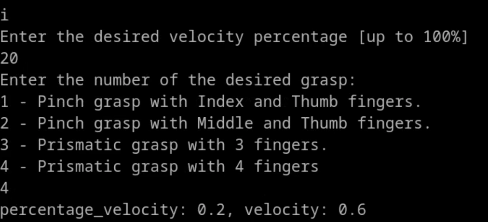

-   **Predefined Hand Configurations:** The program includes several
    predefined hand configurations that can be selected directly:

    -   **Home Configuration:** Option `<h> or <H>`

    -   **Rock:** Option `<r> or <R>`

    -   **Paper:** Option `<m> or <M>`

    -   **Scissors:** Option `<s> or <S>`

    -   **Aloha:** Option `<a> or <A>`

    -   **Punk:** Option `
 or 
`

    -   **Win:** Option `<w> or <W>`

    -   **Botifarra:** Option `<b> or <B>`

    -   **Thumb up:** Option `<u> or <U>`

    -   **One finger:** Option `<o> or <O>`

-   **Exit the Program:** To safely exit the program the user selects
    option `<0>`. The hand is properly stopped before exiting.

### 1-2 Running the Example 

To run this example, the user must specify the hand configuration file,
which can be provided either by the file name (with or without the
`.yaml` extension) or by the full path to the YAML configuration file.

-   **Simulation Mode**

    To run the example in simulation mode, use the following command in
    the terminal:

            $ examples/test_allegro_hand <hand_configuration_file> sim

    For example, with the Allegro Hand model R283 the program can be
    executed using:

            $ examples/test_allegro_hand V4R283 sim
            $ examples/test_allegro_hand V4R283.yaml sim
            $ examples/test_allegro_hand ../conf/configuration_files/V4R284.yaml sim

-   **Real Allegro Hand**

    Ensure that the hand power is activated first (the hand should be plugged in with the switch positioned upward, and the device will display a steady red light). 
    To run the example with the real Allegro Hand, connect the hand to
    the computer and identify the CAN port number. Then, run the following
    command, where hand_configuration_file refers to the name of the file created in [Step 1](../README.md#step-1-create-the-hand-configuration-file).

            $ examples/test_allegro_hand <hand_configuration_file> real

    For example, with the Allegro Hand model R283:

            $ examples/test_allegro_hand V4R283 real
            $ examples/test_allegro_hand V4R283.yaml real
            $ examples/test_allegro_hand ../conf/configuration_files/V4R284.yaml real

In both cases, the hand used is version 4, model right 283, with a
serial number of R283. The `pcan` driver generates the device
`/dev/pcan32`. Replace this with the appropriate number for your setup.

## 2 - Allegro Hand Driver Example

The provided example, `test_allegro_hand_driver`, demonstrates a basic
driver application for the Allegro Hand. This example is designed to
establish communication with the robotic hand and allows for basic
operations without the need for advanced control algorithms. The core
functionality is implemented using the *AllegroHandDriver* class,
providing an interface to interact directly with the Allegro Hand
hardware.

### 2-1 Functionality 

The example program allows the user to perform the following operations:

1.  **Set Direct Torque:** The user can directly set torque values for
    the 16 joints of the hand (4 joints per finger) in Newton-meters
    (option `<1>`).

2.  **Set Finger Torque:** Selecting option `<2>` allows the user to
    specify torque values for individual fingers. Each finger has four
    joints, and the user can provide torque values for each joint.
    Additionally, the specific finger to which the torque is applied can
    be selected.

3.  **Read Hand State (Joint Positions):** The program reads and
    displays the current state of the hand, specifically joint positions
    in degrees (option `<3>`).

4.  **Get Torque Conversion Constant:** Retrieves the torque conversion
    constant used to translate motor currents into torque values (option
    `<4>`). This constant is determined by the hand version and is
    essential for understanding the relationship between the control
    inputs and the mechanical output of the hand.

5.  **Get Torque Limits:** Retrieves the maximum allowable torque for
    each joint (option `<5>`).

6.  **Read Current Torque Values:** Option `<6>` displays the torque
    values currently being applied to the hand's joints.

7.  **Exit the Program:** To safely exit the program, the user selects
    option `<0>`. The hand is properly stopped before exiting.

### 2-2 Running the Example 

To run the `test_allegro_hand_driver` example, the user must provide the
YAML configuration file for the specific Allegro Hand model in use. The
configuration file contains necessary initialization parameters, such as
joint limits, encoder offsets, and control settings. The file can be
specified either by its filename (with or without the `.yaml` extension)
or by providing the full path to the file.

Ensure that the hand power is activated first (the hand should be plugged in with the switch positioned upward, and the device will display a steady red light). 
    To run the example with the real Allegro Hand, connect the hand to
    the computer and identify the CAN port number. Then, run the following
    command, where hand_configuration_file refers to the name of the file created in [Step 1](../README.md#step-1-create-the-hand-configuration-file).

            $ examples/test_allegro_hand_driver <hand_configuration_file> real

For instance, assuming the hand model `V4R283`, the example can be
executed with the following terminal commands:

    $ examples/test_allegro_hand_driver V4R283 real
    $ examples/test_allegro_hand_driver V4R283.yaml real
    $ examples/test_allegro_hand_driver ../conf/configuration_files/V4R284.yaml real

The `real` argument specifies that the hand is not in simulation mode.

## 3 - Additional Examples

In addition to the previous examples, the software package includes
several other examples that demonstrate other functionalities using the
`AllegroHand` class. These include, but are not limited to:

-   *test_allegro_hand_controller*: Demonstrates basic and advanced
    control strategies.

-   *test_motionTypesOneTwo*: Explores different motion types.

-   *test_FK_and_IK*: Implements and tests forward and inverse
    kinematics algorithms.

Each of these examples can be run similarly to the previous examples,
providing a rich set of tools for understanding and controlling the
Allegro Hand.

---
> - 🔙 Go back to the main README file: [0 - Main](../README.md)
> - ⬅️ Previous section: [9 - Installation And Setup](9_InstallationAndSetup.md)
> - ➡️ Next section: [11 - The Official Software](11_TheOfficialSoftware.md)

---

