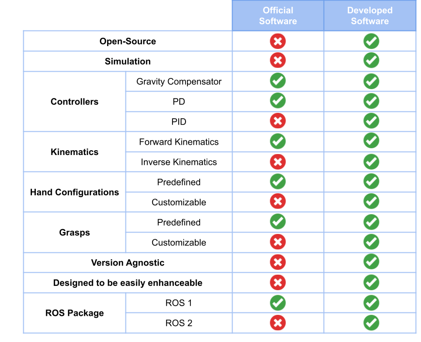

# The Official Allegro Hand Software

---
> - 🔙 Go back to the main README file: [0 - Main](../README.md#conclusion)
> - ⬅️ Previous section: [10 - Testing the Allegro Hand Library](10_Testing.md)
> - ➡️ Next section:  [12 - Miscellaneous](12_Miscellaneous.md) 
---

This section will present deeply the Official Software as well as a comparison with this library focusing on the available functionalities.

The official Allegro Hand software distributed and developed by [Wonik Robotics](https://www.wonik.com/en/business/it?tab=it0) consists of several packages: a shared library called [BHand](https://www.allegrohand.com/grasping-library-for-linux) and one version-specific package for GNU/Linux ([Up to version 3](https://github.com/simlabrobotics/allegro_hand_linux) and [Version 4](https://github.com/simlabrobotics/allegro_hand_linux_v4)) and for Windows ([Up to version 3](https://github.com/simlabrobotics/allegro_hand_windows) and [Version 4](https://github.com/simlabrobotics/allegro_hand_windows_v4)). Additionally, a ROS 1 (Catkin) package for GNU/Linux is provided ([Up to version 3](https://github.com/simlabrobotics/allegro_hand_ros_catkin) and [Version 4](https://github.com/simlabrobotics/allegro_hand_ros)).

|                                         **Windows**                                         |                                      **GNU/Linux**                                     |
|---------------------------------------------------------------------------------------------|----------------------------------------------------------------------------------------|
| [BHand](https://www.allegrohand.com/grasping-library-for-linux) library (distributed only in binary format)                                           |                                                                                        |
| Windows AH version specific package                                                         | GNU/Linux AH version specific package                                                  |
|                                                                                             | ROS 1 AH version specific package                                                      |

The BHand is a software library distributed in binary format only, tailored to control the Allegro Hand. It is shared among all the Allegro Hand versions. The library includes two controllers algorithms: the Gravity Compensator and the Proportional-Derivative (PD), and it also has partial Forward Kinematics (without orientation). Also, it embeds four types of grasps: using 3 fingers, using 4 fingers, pinch with index and thumb, and pinch with middle and thumb. The version-specific package manages communications to interact with the hand's hardware, processes data, and allows for manual control through keyboard inputs. To do so, the BHand library is used. The ROS 1 package is version-specific and uses the previous packages allowing control of the hand within the ROS 1 environment.

This section presents the official software provided by the manufacturer, both the BHand Library and the version-specific package for GNU/Linux, detailing its key features.

## The BHand Library

The [BHand](https://www.allegrohand.com/grasping-library-for-linux) is a software library shared among all the Allegro Hand versions and is specifically tailored to control the Allegro Hands. This library is distributed exclusively in binary format, meaning that it is provided as a precompiled executable rather than in source code form, thus only the necessary header files are provided but not the full source code. Binary format refers to software that has been converted from human-readable source code into machine-readable instructions. Users interact with the library through a set of predefined functions and classes.

The primary limitation of distributing a library solely in binary format is the inherent restriction on modification and extensibility. The original source code is not accessible by the users, this limits any ability to alter the library's functionality, optimize it, or fix potential bugs. Furthermore, extending the library's capabilities, by adding new features (such as new controllers, new grasp types, computing full Forward Kinematics and Inverse Kinematics, among others) becomes significantly more challenging or even impossible without access to the source code. Since the library cannot be modified, any extension must be applied using the provided functions, without any alteration of the BHand code. This constraint limits the library's flexibility and adaptability. As a result, the integration of this library into other projects that require customization or enhancement beyond the provided binary version can be more challenging.

The library includes an enumeration of motion types, such as home positioning, grasping with three or four fingers, and pinching, as well as utilities for partial forward kinematics and control gain adjustments. It offers two controllers: the Gravity Compensator (without considering the hand orientation) and the PD, and it also has partial Forward Kinematics (without orientation).

The architecture of the BHand library is designed to provide an interface for controlling the Allegro Hand. The primary class, BHand, encapsulates all the functionalities:

-   **GetType()**. Retrieves the type of the hand, whether is left or right.
-   **SetTimeInterval()**. Defines the time interval of the control loop. Although the control loop is not contained within the BHand library the controllers require this information.
-   **GetTimeInterval()**. Returns the time interval of the control loop.
-   **SetMotionType()**. Selects the type of motion. The library has defined several motion types, the most relevant ones are:
    -   *eMotionType_NONE*: Power off mode.
    -   *eMotionType_HOME*: Moves the hand to its home position.
    -   *eMotionType_READY*: Prepares the hand in a pregrasp position.
    -   *eMotionType_GRAVITY_COMP*: Gravity compensation controller is activated.
    -   *eMotionType_JOINT_PD*: Joint PD controller is activated.
    -   *eMotionType_GRASP_3*: Torque controlled grasp using 3 fingers.
    -   *eMotionType_GRASP_4*: Torque controlled grasp using 4 fingers.
    -   *eMotionType_PINCH_IT*: Torque controlled grasp pinch using index and thumb.
    -   *eMotionType_PINCH_MT*: Torque controlled grasp pinch using middle and thumb.
    -   *eMotionType_ENVELOP*: Torque controlled envelope grasp.
-   **SetJointPosition()**. Sets the current joint position of each joint [rad].
-   **SetJointDesiredPosition()**. Stores the desired joint positions [rad].
-   **UpdateControl()**. Executes the control algorithm and the desired joint torques are computed.
-   **GetJointTorque()**. Retrieves the desired torques calculated by the controller with the *UpdateControl()* function.
-   **GetFKResult()**. Obtains the partial Forward Kinematics of the fingertips. Although, only the position (X, Y, Z coordinates) and not the orientation (Euler angles).
-   **SetGainsEx()**. Sets the gains of the PD controller.
-   **SetGraspingForce**(). Sets the desired grasping force for each finger.
-   **GetGraspingForce()**. Returns desired grasping force for each finger (individual fx, fy, and fz components per finger).
-   **SetEnvelopTorqueScalar()**. Sets scalar for the preset envelop grasp torque.
-   **SetOrientation()**. Sets the hand orientation, the orientation will be used when computing the necessary torque to neglect the gravity effects.

The workflow for using this library involves the following steps:

1.  **Initialization**: Create an instance of the *BHand* class by providing the type of hand (left or right).
2.  **Configuration**: The user sets various parameters, such as the control time interval (*SetTimeInterval()*), motion type (*SetMotionType()*), the PD controller gains (*SetGainsEx()*), the desired grasping force (*SetGraspingForce()*) or the scalar for the preset envelop grasp torque (*SetEnvelopTorqueScalar()*).
3.  **Control Loop**: Each control loop is executed at the desired time interval. The *UpdateControl()* method is called to compute the desired joint torques based on the current state and the set motion type, finally the computed torques are retrieved. The resulting control loop structure is:

    -   *SetJointPosition()*. Provides the current joint position.
    -   *UpdateControl()*. Executes the controller.
    -   *GetJointTorque()*. Retrieves the computed torques.

    In the event that the hand orientation varies continuously, the orientation of the hand should be updated at every time step through the method *SetOrientation()*. The hand orientation variation is a result of the hand movement, often due to the integration of the hand with other robots, such as the MADAR robot.

The Initialization step is only done only once, while the Control Loop is executed continuously at the desired time step. The user can change the configuration parameters at any time, as well as retrieve the parameters that have previously been selected, such as the type of hand (*GetType()*), the chosen time interval (*GetTimeInterval()*) or the desired grasping force (*GetGraspingForce()*). Moreover, the user can obtain other interesting information, the position (XYZ) in the Cartesian coordinates of the fingertips, through the use of the partial kinematics using *GetFKResult()*.

## The Version Specific Package

The manufacturer provides a version-specific package for GNU/Linux ([Up to version 3](https://github.com/simlabrobotics/allegro_hand_linux) and [Version 4](https://github.com/simlabrobotics/allegro_hand_linux_v4)) and for Windows ([Up to version 3](https://github.com/simlabrobotics/allegro_hand_windows) and [Version 4](https://github.com/simlabrobotics/allegro_hand_windows_v4)) that allows controlling a real hand. The package uses CAN communication to interact with the hand's hardware, processes data, includes some predefined configurations and allows for users to control the hand through keyboard inputs. The BHand library is central to the program as it provides the necessary functions to control the Allegro Hand.

This package manages the CAN communications, allowing the transmission and reception of data to/from the Allegro Hand. The main difference between Allegro Hand versions lies in the communications protocol, with version 4 differing the most. For this reason, the package to be downloaded depends on the Allegro Hand version being used. For GNU/Linux and Windows, there exists one package for version 4 and another package for versions 1, 2, and 3. The package up until version 3 requires the user to manually change the *main.cpp* file and add the communication parameters that correspond to the specific Allegro Hand. These parameters are the encoder offset, encoder direction, and the motor direction, which vary with each hand.

The code structure is shared among all version-specific GNU/Linux packages. First, the program creates an instance of the *BHand* class and sets the time interval of the control loop. Then, it initializes periodic communications with the Allegro Hand. A dedicated thread, *ioThreadProc()*, continuously reads the messages received from the Allegro Hand. Upon receiving a message with the current joint positions, the desired torque is calculated using the BHand library; it first updates the current and desired joint positions of the *BHand* object, then executes the control algorithm to obtain the desired torques, and finally sends the computed torques to the hand.

The user interacts with the program through keyboard commands, which are interpreted by the *MainLoop()* function. In *MainLoop()*, the program waits for the user input to control the hand. The available commands allow users to:

-   Move the hand to its home position using the Proportional-Derivative control (option `<H>`).
-   Move the hand to the pregrasp position using the Proportional-Derivative control (option `<R>`).
-   Execute a torque-controlled grasp using 3 fingers (option `<G>`).
-   Execute a torque-controlled grasp using 4 fingers (option `<K>`).
-   Execute a torque-controlled pinch grasp using index and thumb (option `
`).
-   Execute a torque-controlled pinch grasp using middle and thumb (option `<M>`).
-   Execute a torque-controlled envelope grasp (option `<E>`).
-   Set the Gravity Compensation controller (option `<A>`).
-   Set the servos power off (option `<F>`).
-   Quit the program (option `<Q>`).

The program also provides feedback to the user via the console, such as the status of the hand, its joint positions, and any errors encountered during operation.

To sum up, the official code allows the user to control the Allegro robotic hand. It manages communications, includes a Gravity Compensator and a Proportional-Derivative controller, and has four predefined grasps.

## Conclusions

The provided official software is a useful tool for controlling the Allegro Hand by managing CAN communications.

The Allegro Hand hardware is designed to receive desired torque commands, which limits its functionalities and applications. For advanced implementations such as grasping an object with stability and accuracy, a control mechanism is needed. The official software provides two control mechanisms:

-   **Gravity Compensator Controller**: Calculates and provides the necessary torque to counteract the effects of gravity on the hand. Counteracting gravity is crucial since the fingers are not weightless. The BHand library allows updating the overall hand orientation (*SetOrientation()*), so gravity effects can be neutralized regardless of the hand orientation, as long as the hand orientation is known.

-   **Joint Position Proportional-Derivative Controller**: Employs a Proportional-Derivative control algorithm to regulate joint positions. A Proportional-Derivative controller considers the current error (the difference between the desired and actual joint positions) and the rate of change of this error, providing proportional and derivative actions. This controller allows calculation and setting of desired joint positions. The BHand library also allows modifying the gains of the Proportional-Derivative controller, \( k_p \) and \( k_d \) (*SetGainsEx()*).

The choice of the control algorithm significantly impacts hand performance. While the official BHand library uses a Proportional-Derivative controller, other controllers, like Proportional-Integral-Derivative, offer additional benefits, such as correcting steady-state errors more effectively and are better suited for grasping objects and holding positions.

Additionally, four types of grasps are available: grasp using 3 fingers, grasp using 4 fingers, pinch with index and thumb, and pinch with middle and thumb. However, there is no mechanism for storing new hand configurations or grasps.

Regarding the kinematics, the BHand library allows computation of partial forward kinematics. Although the manufacturer provides access to the current fingertip positions, it does not provide fingertip orientations. Furthermore, partial forward kinematics can only be computed considering the default fingertip configuration. Full forward kinematics are crucial in grasping applications, as the normal force of contact points is important for evaluating grasp quality. Moreover, there is no built-in support for inverse kinematics, a useful tool for controlling the hand by setting fingertip positions (X, Y, Z coordinates) and orientations (Euler angles), rather than joint torques. Inverse Kinematics are essential for moving fingertips to desired contact points in a grasp, contributing to stable grasps.

The manufacturer offers a package for controlling the Allegro Hand within the ROS 1 environment, enabling seamless integration with other robotic systems. However, they currently do not provide a ROS 2 package. This is increasingly important as ROS 1 is only compatible up to Ubuntu 20.04, limiting future compatibility and support as the robotics community shifts toward ROS 2. ROS 2 introduces significant improvements in performance, security, and real-time capabilities. The absence of a ROS 2 package may restrict long-term flexibility and integration potential with modern robotics platforms.

The provided software is helpful but lacks many important features, such as full forward kinematics, inverse kinematics, a Proportional-Integral-Derivative controller, customizable hand configurations and grasps, among others. Additionally, the proprietary nature of the BHand library limits the ability to fully understand, customize, and enhance the system.

This gap is addressed in the developed software, Allegro Hand Library. By incorporating full forward kinematics, inverse kinematics, and customizable hand configurations and grasps, the new software significantly improves the hand's functionality. Moreover, it allows for more precise and intuitive control through the use of a Proportional-Integral-Derivative controller. The newly developed open-source software is a robust tool. Furthermore, a ROS 2 package has also been created for controlling the hand within the ROS 2 environment, enhancing its potential applications. This enhancement not only expands the capabilities of the Allegro Hand but also provides a more powerful platform for research and development in robotic manipulation and grasping theory.

### Comparison with the Offical Software
The developed software is open source and
allows for controlling all Allegro Hand versions using both a real hand
or a simulated one. Moreover, it incorporates PID controller, and full
FK and IK. Additionally, it
contains both predefined and customizable hand configurations and
grasps. While the manufacturer only provides a ROS 1 package, the developed software
includes both a ROS
1 and ROS 2
packages.

The comparison between the official software and the this library, Allegro
Hand Library, is shown below: 

    

---
> - 🔙 Go back to the main README file: [0 - Main](../README.md#conclusion)
> - ⬅️ Previous section: [10 - Testing the Allegro Hand Library](10_Testing.md)
> - ➡️ Next section:  [12 - Miscellaneous](12_Miscellaneous.md) 
---