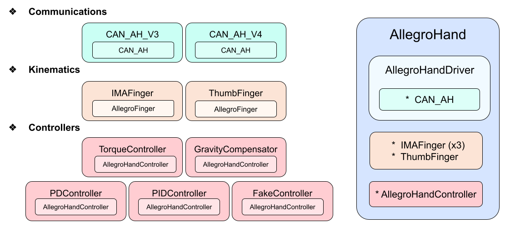
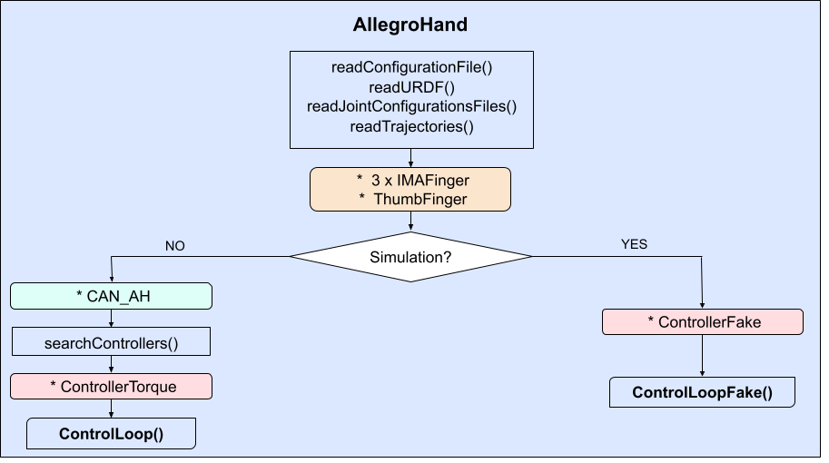
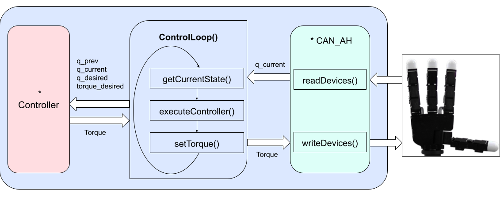
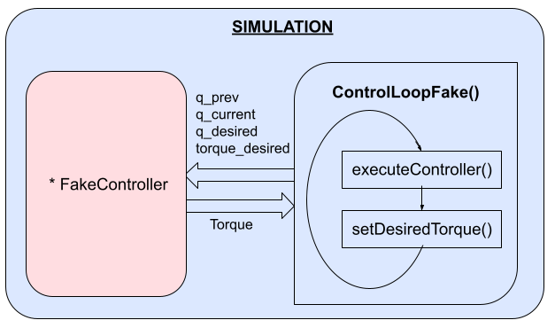

# 2 - Code Structure

---
> - 🔙 Go back to the main README file: [0 - Main](../README.md#code-structure)
> - ⬅️ Previous section: [1 - Key Functionalities](1_KeyFunctionalities.md)
> - ➡️ Next section: [3 - Directory Organization](3_DirectoryOrganization.md)
---

The software has a modular design, a global description of the software classes how do they are interconnected is presented in this section. 
Next chapters deeply explain all classes and their corresponding functions.

The code structure is divided into five classes:

    

## 2.1 The communication class: CAN_AH

It enables communication with the AH. It allows to start and stop
communications, generates messages to send torques and parses the
received messages to get the current configuration.

## 2.2 The controller class: AllegroHandController

The software has five different control modes: Torque, Gravity
Compensator, PD, PID and Fake controller. (each controller being a
subclass of the *AllegroHandController* class):

-   *Torque*. Sets and maintains the desired torques.

-   *GravityCompensator*. Calculates the needed torques to counteract
    the effects of gravity using the Kinematics and Dynamics Library
    (KDL).

-   *JointPositionPD*. Uses a PD control to achieve desired joint
    positions, considering gravity effects.

-   *JointPositionPID*. Uses a PID control to achieve desired joint
    positions, considering gravity effects.

-   *Fake*. Used only for simulation, computes the gravity compensation
    torques and updates the virtual hand state.

## 2.3 The Kinematic class: AllegroFinger

It has two child classes, one for the Index, Middle and Annular (IMA)
fingers *IMAFingers*, and another for the Thumb, *ThumbFinger*. The IMA fingers structure is the
same, whereas the Thumb kinematics is different. This class contains the
implementation of FK and a closed form of the IK of the IMA and Thumb
fingers. The implementation allows to move the fingertips to the desired
positions (X, Y, Z coordinates) and orientations (Euler angles) through
the use of the IK and read the current poses of each fingertip through
FK.

## 2.4 The basic driver class: AllegroHandDriver

It is a basic driver to communicate with the hand. It reads the hand
configuration file and allows reading the current joint positions and
setting specific torques. It contains an instance of the *CAN_AH* class.

## 2.5 The primary class: AllegroHand

The *AllegroHand* class is the most crucial, since it is a derived class
from the *AllegroHandDriver* and embeds instances of the other classes.
When initialized it reads a configuration file, the URDF and predefined
joint configurations and grasp modes. It can run both, a real
Allegro Hand or a simulated one. It instantiates a *AllegroController*
class (Torque or Fake for real or simulated, respectively) and four
instances of the kinematic classes (one per finger). 
In both cases it
contains a thread executing the main -and only- loop, *controlLoop* or
*controlLoopFake*. 
When working with a physical hand, it initializes an
instance of the *CAN_AH* class for communication and finds the available
controllers. 
The *controlLoop* reads current joint configurations,
executes the current controller and sends the desired torques to the
Allegro Hand. The *controlLoopFake* executes the fake controller,
ensuring the desired torques are within the limits of the simulated hand.

    

### The control thread

The control thread is the most important part of the *AllegroHand* class, it contains a control loop in order to continuously control the AllegroHand.
<!-- The AllegroHand hardware is controlled through torque commands, which can be translated into intensity ones multiplying the torque by a constant, as the equation below shows.
 -->
<!-- $$I = k \cdot \Gamma$$ -->
- When operating a real hand.
    The *controlLoop* iteratively:
    1) Reads current joint configurations from the Allegro Hand, *getCurrentStateComm*.
    2) Executes the current controller to get the desired torque. *executeController*
    3) Sends the desired unsatturated torques to the Allegro Hand. *setTorque*

    
     <!--  -->

- When operating a simulated hand.
    The *controlLoopFake* iteratively:
    1) Executes the fake controller. *executeController*
    2) Makes sure that the desired torques are within the limits of the simulated hand and if not calculates the unsatturated torques. *setDesiredTorque* 

    <!--  -->
     

### Summary of Allegro Hand Functions
The *AllegroHand* key functions include:
- Control algorithms. 
It allows users to obtain a list of the available controllers, set the desired controller, get the current controller and obtain joint position errors. 
It can also get and set the hand gravity vector, used to calculate the necessary torque to compensate the gravity effect,
considering the hand orientation.
This feature is important when the hand is installed on a robot arm whose movement affects the hand gravity vector.
When switching the controller, the previous controller instance is deleted, ensuring efficient memory management.
    
- Hand configuration. 
It allows to obtain the current joint positions and set the desired ones. 
It can read YAML files with predefined configurations, list all saved configurations, temporarily add and delete configurations from the list, permanently store a configuration into the desired YAML file and move the hand to a new or a predefined configuration, among other functionalities.
    
- Grasps modes.
    It allows to move the hand to a predefined grasp configuration along a given trajectory.
    Additionally, it can read and store trajectories to perform different grasp types from YAML files. 
    There are two ways of storing grasps:
    Provided an initial and final configuration and the desired speed, a trajectory is computed by interpolating the joint positions. 
    Additionally, a grasp can be generated by recording the positions of the manually manipulated hand. 
    
- Forward and Inverse Kinematics.
    These functions compute the FK, which return the position and orientation of the fingertips. 
    Conversely, the IK of the hand functions provide the corresponding joint values to allocate the fingertips at the desired pose. 
    Moreover, there is a function to obtain the Jacobian, which uses the kinematic chain built from the URDF model using the KDL library.
    
- Joint limits. 
    A program, *calculate\_joint\_limits*, located in the *examples* folder, has been developed to store in a YAML file the read minimum and maximum real joint values. 
    The problem of the discrepancies in the joint limits between the manufactured hands and the official URDF limit values has been solved by changing the URDF limits using the empirical read values from version 4, which exhibit consistency across manufactured hands. 
    For earlier AH versions, the program can also adjust the *encoderOffset* values in the hand configuration file to minimize limit differences and center the range. 
    The developed software accounts for both the URDF limits and the real limits from the YAML file, including a safety margin. 
    Functions are provided to obtain joint limits, set a safety margin (by a general value, percentage, or specific value for each joint), and choose whether to apply the safety margin. In the section Some important considerations > Limit values and ranges of the joints this problem and the step-by-step solution is explained in detail.

---
> - 🔙 Go back to the main README file: [0 - Main](../README.md#code-structure)
> - ⬅️ Previous section: [1 - Key Functionalities](1_KeyFunctionalities.md)
> - ➡️ Next section: [3 - Directory Organization](3_DirectoryOrganization.md)
---

