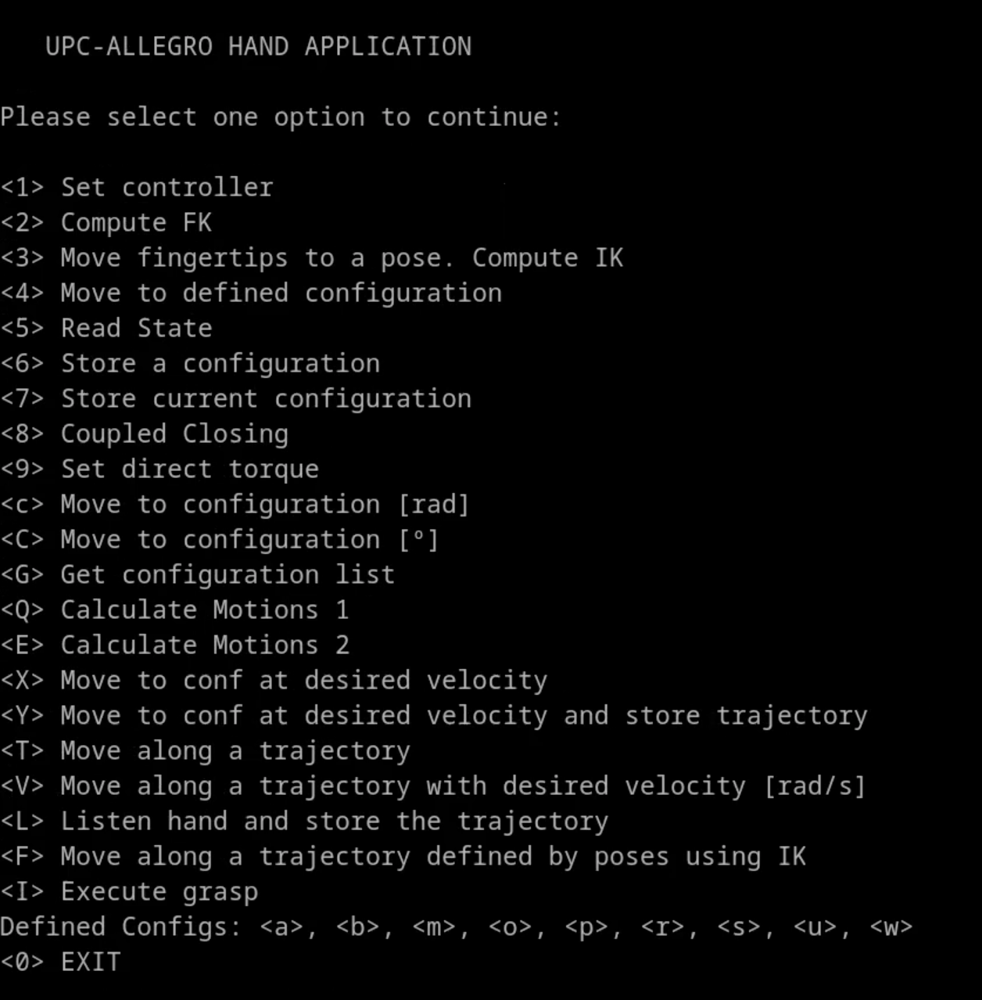

# Installation and Setup

---
> - 🔙 Go back to the main README file: [0 - Main](../README.md#step-by-step-initial-instructions)
> - ⬅️ Previous section: [8 - The Primary Class: AllegroHand](8_AllegroHandClass.md)
> - ➡️ Next section: [10 - Testing the Allegro Hand Library](10_Testing.md)
---

Congratulations on acquiring an Allegro Hand!
This section will provide a step by step guide to use this library.

- **Step 0:** The initial step consists on setting up the power supply and communication hardware according to the [official wiring information.](https://www.allegrohand.com/wiring-and-connector-info) This step is only necessary once when you have bought the hand.

## Step 1: Create a Hand Configuration File
 Create the configuration file for your hand. 
Go to the directory: conf/configuration_files and use either the right hand or left hand template ([Right_template](/conf/configuration_files/Right_template.yaml) and [Left_template](/conf/configuration_files/Left_template.yaml), respectively).
This file contains basic information such as communication parameters necessary to operate the hand.
This step is simple and straightforward, nevertheless the template files contain a step by step instruction.

## Step 2: Install the necesary requirements
To build this library, the following dependencies are required:

- [**CMake**](https://www.cmake.org)
- [**Eigen**](https://eigen.tuxfamily.org/index.php?title=Main_Page)
- [**yaml-cpp**](https://github.com/jbeder/yaml-cpp)
- [**pcanbasic**](https://www.peak-system.com/PCAN-Basic-API.199.0.html)
- [**libpcan**](https://www.peak-system.com/fileadmin/media/linux/index.htm)
- [**Boost**](http://www.boost.org)
- [**URDF**](http://wiki.ros.org/urdf)
- [**Orocos KDL**](https://github.com/orocos/orocos_kinematics_dynamics)

On a Debian/Ubuntu system, these dependencies can be installed using:
```
    $ sudo apt install cmake libeigen3-dev libyaml-cpp-dev libboost-filesystem-dev 
    libboost-system-dev liburdf-dev liborocos-kdl-dev
```
For libpcan, use the packages available for Debian or Ubuntu.

-   For Debian, add the Debian Robotic Project (DRP) repository by
    replacing `XXXX` with `bookworm` or `bullseye`:
    ```
            $ sudo sh -c 'echo "deb [arch=amd64] http://debrob.upc.edu/debian-robotics 
            XXXX-robotics main" > /etc/apt/sources.list.d/debian-robotics.list'
            $ sudo apt update
            $ sudo apt install libpcan-dev
    ```

-   For Ubuntu Focal (20.04), add the relevant PPA:
    ```
            $ sudo add-apt-repository ppa:deb-rob/focal-robotics
            $ sudo apt update
            $ sudo apt install libpcan-dev
    ```

The driver uses a modified version of `kdl_parser` by Wim Meeussen,
adapted by Pouya Mohammadi, which is not integrated with ROS.

## Step 3: Build the driver

To compile the project: first, create a build directory and execute the command cmake:

```bash
$ mkdir build
$ cd build
$ cmake ../
```

Then execute the command:

```bash
$ make
```

Upon successful compilation, the library output includes:

-   The shared library *liballegro_hand.so*.
-   Several example programs to test the library.

## Step 4: Testing the Allegro Hand Library

There are several examples to test the Allegro Hand Library. 
In this section the most complete example will be briefly presented.
This example allows the user to control through keyboard commands the Allegro Hand.
The available commands are:
<p align="center">
    
</p>

- **Select a Controller:** The user can select from available controllers such as Gravity Compensator, PD, PID, or Torque controllers by entering the corresponding number (option `<1>`).
- **Forward Kinematics (FK):** The program computes and prints the Forward Kinematics of the fingertips (option `<2>`). This calculation provides the positions (Cartesian coordinates: X, Y, Z) and orientations (ZYZ Euler angles) of each fingertip.
- **Inverse Kinematics (IK):** The user can move the fingertips to a desired position and orientation using Inverse Kinematics (option `<3>`). This requires specifying 12 position values and 12 orientation values of the fingertips.
- **Move to a Defined Configuration:** The user can move the hand to a predefined configuration by specifying its name (option `<4>`).
- **Read Hand State:** The program reads and displays the current state of the hand, including joint positions in degrees and radians, velocities in degrees per second, accelerations in degrees per second squared, and torques in Newton-meters (option `<5>`).
- **Store a Configuration:** The program allows the user to manually move the hand (with the Gravity Compensator automatically activated) and save the current configuration to a YAML file under a specified name (option `<6>`).
- **Perform a Coupled Closing:** The program enables a coupled closing of the hand (option `<8>`).
- **Retrieve Configuration List:** The program lists all available configurations stored in the YAML files (option `<G> or <g>`).
- **Move to a Predefined Configuration at a Desired Velocity:** The user can specify a configuration name and a velocity percentage (up to 100%) to move the hand at the desired speed (option `<X> or <x>`).
- **Store and Execute a Trajectory:** The user can define a velocity and a final configuration name (option `<Y> or <y>`). The hand moves from the current configuration to the user-selected final configuration.
- **Move Along a Predefined Trajectory:** The user can move the hand along a trajectory defined as a list of configurations (`<T> or <t>`).
- **Record and Store a Trajectory:** The program can listen to the manually manipulated hand and store the movement trajectory.
- **Execute grasps:** The program can execute some predefined grasps (option `<i> or <I>`).
    -   **Prismatic grasp using 3 fingers:** Executes a prismatic grasp
        using 3 fingers, the Index, the Middle and the Thumb (option
        `<1>`).
    -   **Prismatic grasp using 4 fingers:** Executes a prismatic grasp
        using all 4 fingers (option `<2>`).
    -   **Pinch grasp using 3 fingers:** Executes a pinch grasp using 2
        fingers, the Index and the Thumb (option `<3>`).
    -   **Pinch grasp using 3 fingers:** Executes a pinch grasp using 2
        fingers, the Middle and the Thumb (option `<3>`).
-   **Predefined Hand Configurations:** The program includes several
    predefined hand configurations that can be selected directly:
    -   **Home Configuration:** Option `<h> or <H>`
    -   **Rock:** Option `<r> or <R>`
    -   **Paper:** Option `<m> or <M>`
    -   **Scissors:** Option `<s> or <S>`
    -   **Aloha:** Option `<a> or <A>`
    -   **Punk:** Option `<p> or <P>`
    -   **Win:** Option `<w> or <W>`
    -   **Botifarra:** Option `<b> or <B>`
    -   **Thumb up:** Option `<u> or <U>`
    -   **One finger:** Option `<o> or <O>`
-   **Exit the Program:** To safely exit the program the user selects
    option `<0>`. The hand is properly stopped before exiting.


#### Running the Main Example 

To run this example, the user must specify the hand configuration file,
which can be provided either by the file name (with or without the
`.yaml` extension) or by the full path to the YAML configuration file.

-   **Real Allegro Hand**
    
    Ensure that the hand power is activated first (the hand should be plugged in with the switch positioned upward, and the device will display a steady red light). 
    To run the example with the real Allegro Hand, connect the hand to
    the computer through the PCAN device and identify the CAN port number. 

    Then, run the following command, where hand_configuration_file refers to the name of the file created in [Step 1](../README.md#step-1-create-the-hand-configuration-file).

            $ examples/test_allegro_hand <hand_configuration_file> real

    For example, with the Allegro Hand model R283:

            $ examples/test_allegro_hand V4R283 real
            $ examples/test_allegro_hand V4R283.yaml real
            $ examples/test_allegro_hand ../conf/configuration_files/V4R284.yaml real

-   **Simulation Mode**

    To run the example in simulation mode, use the following command in
    the terminal, where hand_configuration_file refers to the name of the file created in [Step 1](../README.md#step-1-create-the-hand-configuration-file).

            $ examples/test_allegro_hand <hand_configuration_file> sim

    For example, with the Allegro Hand model R283 the program can be
    executed using:

            $ examples/test_allegro_hand V4R283 sim
            $ examples/test_allegro_hand V4R283.yaml sim
            $ examples/test_allegro_hand ../conf/configuration_files/V4R284.yaml sim


In both cases, the hand used is version 4, model right 283, with a
serial number of R283. The `pcan` driver generates the device
`/dev/pcan32`. Replace this with the appropriate number for your setup.

> - More information available in: [10 - Testing the Allegro Hand Library](10_Testing.md). Contains the examples available.


## Integrating the Driver into a Project

The driver is designed to be built within a catkin workspace. To
incorporate it into your own project, include the following lines in
your `CMakeLists.txt` file:
```
    $ find_package(allegro_hand_driver REQUIRED)
    $ get_target_property(allegro_hand_INCLUDE_DIRS ${allegro_hand_LIBRARIES} 
    INTERFACE_INCLUDE_DIRECTORIES)
    $ include_directories(${allegro_hand_INCLUDE_DIRS})
    # Ensure to link ${allegro_hand_LIBRARIES} appropriately in your target.
```

---
> - 🔙 Go back to the main README file: [0 - Main](../README.md#step-by-step-initial-instructions)
> - ⬅️ Previous section: [8 - The Primary Class: AllegroHand](8_AllegroHandClass.md)
> - ➡️ Next section: [10 - Testing the Allegro Hand Library](10_Testing.md)
---